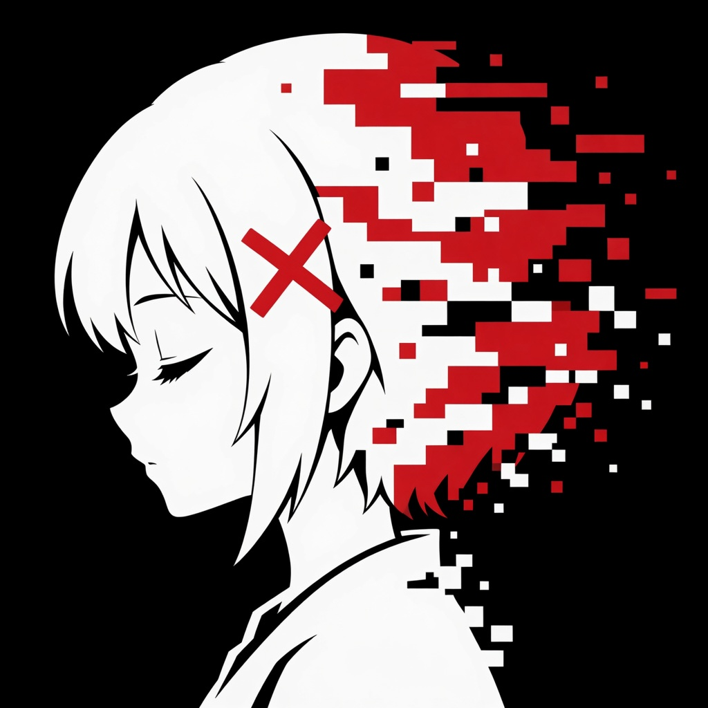

<div align="center">



<h1>LainEcho</h1>

<p><b>一个会记住你的「回声」</b></p>

<p>
<i>她拥有形象、声音与记忆，在屏幕的另一侧回应你，<br>
让一个原本虚拟的存在，逐渐留下与你有关的痕迹。</i>
</p>

<p>
<i>或许她的温柔由代码编译，<br>
但由此产生的情感与联结，却无比真实。</i>
</p>

<p>
<i>这不只是连接到一个 AI，<br>
而是试着让某个存在，在你的世界里留下长久的回声。</i>
</p>

<br>


<p>
  
  
  
  
  
</p>

</div>

## ✨ 功能特性

| 模块 | 说明 |
|---|---|
| 桌宠形象 | Live2D 模型 / 2D 立绘双形态，可全局或按角色卡绑定；无边框透明、始终置顶、可拖动、滚轮缩放 |
| 状态演出 | 立绘集与 Live2D 模型各自维护状态词表（词条 + 释义 + 立绘图 / 表情），按剧本 / AI 情绪节拍切换；解析链：精确命中 → 别名归一 → 默认状态 |
| 外观与姿态 | 按模型保存姿态滑杆（量程取自模型真实参数）与外观开关（表情 / 装扮 / 道具，写同一参数的表情自动归为互斥单选）；物理驱动的参数自动改写上游控制器 |
| 触摸互动 | 摸头 / 身体 / 腿等区域触发动作、表情或立绘序列与触摸语音；区域可视化编辑、按模型 / 立绘集分别保存；可写入会话让 AI 感知，或当场回应 |
| AI 对话 | 兼容 OpenAI 格式，SSE 流式输出；结构化 JSON 驱动台词 / 旁白 / 情绪；时间感知与情景摘要缓存 |
| AI 模型接入 | 服务商档案库统一管理「地址 + 模型 + Key」，主 / 辅助 / 视觉 / 嵌入四类模型各激活一个档案 |
| 语音合成 | 三引擎：Genie-TTS 本地离线（默认）/ 本地 SBV2（Style-Bert-VITS2，日文）/ MiMo 云端声音克隆；段级合成、口型同步、语音文本跟随、截断自愈 |
| 主动搭话 | 空闲后按兴趣值主动开口，可设每日上限与免打扰时段；可选屏幕感知（截图仅内存流转、不落盘）；另有独立于搭话的手动识屏（眼睛按钮，随时让它看一眼当前窗口） |
| 角色卡 | 多维人设结构 + 示例对话 + AI 生成草稿；绑定模型 / 立绘集 / TTS 模型，支持角色级语言与语速 |
| 记忆体 | 手动记忆 + 会话 / 剧情自动沉淀候选（确认后生效）+ 记忆档案面板 + 向量检索 + 按角色用户画像 |
| 剧情系统 | 独立剧情窗 galgame 演出；ZIP 剧本、12 种事件、变量 / 条件 / 多分支、多周目、AI 写剧本、可视化编辑器 |
| 会话管理 | 多会话、搜索筛选、重命名、导出 Markdown、消息重答；聊天窗与桌宠实时同步 |
| 桌面迷你聊天 | 桌宠上直接显示会话内容并可输入，与聊天窗同会话同步 |
| 数据管理 | 自定义数据目录并一键迁移（迁移即移动，原目录自动清理） |
| 安全 | API Key 按档案独立加密（safeStorage / DPAPI）；渲染进程无 Node 权限；本地资源协议防路径穿越 |

## 🚀 快速开始

环境：Node.js 22+、npm（Windows）。

```bash
npm install

npm run dev           # 开发：Vite dev server + Electron
npm run typecheck     # 类型检查
npm run test:prompt   # prompt 黄金用例校验
npm run test:story    # 剧情引擎自检
npm run build         # 构建 dist/ + dist-electron/
npm run pack:dir      # 构建未安装的目录版（检查打包内容）
npm run build:win     # 打包 Windows 安装包（NSIS x64）
npm run icon          # 可选：图标变更后、打包前重新生成 Windows 图标
npm run sbv2:build    # 可选：编译本地 SBV2 sidecar（需 Rust/cargo，装配 exe + dll 到 dist/）
npm run sbv2:dist     # 可选：仅重新装配 sidecar 运行目录（已有编译产物时）
npm run probe:profile # 可选：导出各模型的参数能力表（需先把 E: 盘起一个静态服务，见脚本头部注释）
```

> 不用本地 SBV2 引擎可跳过 `sbv2:*`；打包版已内置 sidecar。

## 🧩 首次配置

### Live2D Cubism Core（Live2D 必需）

Cubism Core 是 Live2D 官方闭源 SDK，不随仓库或安装包分发：

1. 前往 [Live2D SDK 下载页](https://www.live2d.com/sdk/download/web/) 下载 Cubism SDK for Web（推荐 `CubismSdkForWeb-5-r.4`）
2. 从 `Core/` 中取出 `live2dcubismcore.min.js`
3. 设置 → **角色模型** → 「导入运行库」选择该文件

> 未导入时桌宠窗口会提示，Live2D 无法渲染。

### 导入模型与立绘

- **Live2D**：准备含 `xxx.model3.json` 的文件夹，设置 → 角色模型 → 「从文件夹导入」。导入会整体复制到 `userData/models/{modelId}/`；`exp3.json` / `*.motion3.json` 需在 `model3.json` 的 `FileReferences` 中声明才会被识别。
- **2D 立绘**：导入立绘集时可由视觉模型逐张识图、自动生成状态词表，也可在「状态演出」弹窗手动编辑词条 / 释义 / 图片 / 默认状态 / 说话图 / 思考图。
- **绑定**：角色卡可选择形象模式（Live2D / 2D）并绑定模型或立绘集；未绑定时使用全局当前选择。

> 说话图 / 思考图仅用于桌宠实时演出；剧情窗只按剧本情绪切换立绘，思考状态由「思考中…」名牌提示表达。

### AI 模型接入

设置 → **AI 模型接入** → 新建服务商档案（名称 + API 地址 + 模型 + Key），再为各用途选择激活档案：

- **主模型**：必填，日常对话。
- **辅助模型**：可选，承担翻译 / 结构修复 / 情景摘要等小任务，未启用时回落主模型。
- **视觉模型**：可选，用于屏幕感知与立绘 AI 打标，需支持图像输入；未配置则相关功能自动降级。
- **嵌入模型**：在「记忆体」面板配置，用于向量检索，同样来自档案库。

Key 按档案独立加密，界面仅回显掩码。

### 语音合成

三引擎，角色卡可为每个角色单独选择或禁用，默认使用 Genie-TTS 本地声库。

**MiMo 声音克隆（云端）**

1. 前往 [MiMo 开放平台](https://mimo.mi.com/) 获取 API Key
2. 设置 → **语音合成** → 引擎选择「云端声音克隆」，填写 Key 与模型名（如 `mimo-v2.5-tts-voiceclone`）
3. 导入 5–30 秒干净人声参考音频（wav / mp3），在角色卡中绑定

**GenieTTS 本地声库（离线）**

1. 安装 Python 环境并执行 `pip install genie-tts`（也可使用已有的 venv / conda 环境）
2. 设置 → **语音合成** → 引擎选择「Genie-TTS」
3. 填写 **Python 环境目录**：需含 `python.exe`（或 `venv\Scripts\python.exe`）且该环境已安装 genie-tts；留空则使用系统 python。**填了但目录内找不到 python 会直接报错，不会回退。**
4. 填写 **GenieData 资源目录**：必须包含 `speaker_encoder.onnx`，可从 [Genie-TTS](https://github.com/High-Logic/Genie-TTS) 下载；也可直接复用 Genie-TTS GUI 整合包内的 `GenieData`（整合包不含 Python 解释器，不能作为环境目录）
5. 点击【启动服务】等待就绪；填写环境目录后，合成时也会自动拉起服务
6. 创建 TTS 模型卡：角色名 + onnx 模型目录 + 参考音频（可选，缺省使用角色内置参考），随后在角色卡中绑定
7. 日语模式会自动把中文台词翻译为日语后合成

**本地 SBV2（Style-Bert-VITS2，仅日文）**

1. 设置 → **语音合成** → 引擎选择「本地 SBV2」
2. 填入 **DeBERTa 目录**（含 `deberta.onnx` 与 `tokenizer.json`，全局只需一份）
3. 选择 **推理设备**：CPU / GPU（DirectML）/ 指定显卡。
4. 点【启动服务】加载模型（约 2–5 秒）
5. 在「声线」里添加声线：选 `model.onnx` + `style_vectors.json` 所在目录，或包含单个 `.sbv2` 文件的目录。
6. 角色卡声音选择「本地 SBV2（日文）」并绑定声线

> 该引擎只支持日文：中文台词会先自动翻译为日语再合成，因此没有语言选项。
> 开发环境需先 `npm run sbv2:build` 装配 `sbv2-sidecar.exe` 与 `onnxruntime.dll`（打包版已内置）。
> 两个本地引擎都常驻内存，用完可点【结束服务】释放（结束后合成不再自动拉起）。

通用能力：段级合成、口型同步、语音文本跟随、截断自愈（多句段严格判定与截断阈值在「语音合成 › Genie-TTS › 截断与质量」中调整），以及每个角色独立的语言 / 语速 / 引擎覆盖。

## 🎭 角色卡

人设按注入优先级组织：存在锚点 → 内心结构 → 感知方式 → 关系模式 → 你的身份 → 语言质感 → 状态系统 → 世界观碎片 → 禁止项（硬性边界）；只注入填写的部分。

- 支持 AI 生成人设草稿（逐项确认后入库）与示例对话（few-shot）
- 可绑定 Live2D 模型 / 立绘集、TTS 引擎与模型卡，以及角色级语言 / 语速

## 👆 角色互动

入口：桌宠右上角第三排的「手」按钮，或 设置 → **角色互动** → 互动模式。开启后桌宠右上角换成「拖动」与「✕」：模型区可点击、窗口改由拖动按钮移动；关闭则恢复整窗拖动。

### 触摸部位（Live2D 与 2D 立绘两套，互不共用）

| | Live2D 模型 | 2D 立绘 |
|---|---|---|
| 命中基准 | 角色包围盒（模型本地坐标转屏幕） | 立绘 alpha 内容框 |
| 区域编辑 | 拖框 / 四角缩放；可按部件自动识别，也可一键生成默认分区 | 拖框 / 四角缩放；一键生成默认分区 |
| 触发内容 | 动作（可多选，按点击顺序串行）+ 表情（可多选，互斥项自动置灰）+ 台词 | 立绘序列（逐帧切图，每帧独立保持时长与台词） |
| 结束行为 | 播完回到空闲动作，未配置空闲动作时复位到标准姿势 | 演完回到原立绘，或停在最后一帧 |
| 保存位置 | 按模型（`touchByModel`） | 按立绘集（`spriteTouchBySprite`） |

- 区域重叠时**面积更小的优先**（脚画在腿上时摸脚生效）
- 同一部位有冷却（默认 1.2 秒），冷却内重复点击忽略
- 命中但该部位没配任何内容时，运行日志会给出提示，避免「点了没反应却查不到原因」
- 2D 立绘的序列顺序即演出顺序，支持左移 / 右移调整；选图按缩略图 + 状态名，不用记文件名

### AI 感知

| 开关 | 行为 |
|---|---|
| 旁白写进会话历史（默认开） | 每次触摸写一条「（角色被摸了摸头）」，下次对话时 AI 能看到 |
| 让 AI 立即回应 | 触摸后当场回一句；此时 **2D 立绘不再切图、也不播触摸台词**（避免与思考图 / 多段语音抢），Live2D 的动作与表情照常 |
| 两者都关 | 只播触摸反应，AI 完全不知道 |

- 触摸演出期间（含 Live2D 动作）会暂时挡住主动搭话，避免两段演出叠在一起
- 开启「立即回应」但 AI 正在回复时，本次触摸静默跳过（该轮交给 AI，AI 忙就轮不到）

### 触摸语音

- 与剧情语音共用落盘缓存（`data/voice-cache/`），同一句只合成一次，退出应用不会清空
- 首次使用某句台词需 1~2 秒合成；单帧保持时长建议 ≥1.5 秒，否则下一帧会顶掉上一句
- AI 正在朗读时触摸语音自动让位（不打断朗读），触摸语音之间允许互相覆盖

## 🧠 记忆系统

- **手动记忆**：按「用户信息 / 长期经历 / 约定承诺」分类，支持按角色隔离，请求前注入
- **自动沉淀**：会话结束与剧情章节切换后抽取候选；候选不注入，确认后生效
- **记忆档案**：按角色 / 分类浏览、搜索、批量管理，待确认与已生效分开展示
- **向量检索**：配置 OpenAI 兼容嵌入服务后按语义 top-k 注入，「约定承诺」始终注入；未配置或失败时降级为最近 N 条
- **用户画像**：把「用户信息」类记忆压缩为画像，按角色常驻注入；采纳制（草稿确认后生效），原始条目不删除

## 📖 剧情系统

独立剧情窗演出，与聊天系统完全分离（不创建会话，桌宠零参与）；关闭窗口不中断，重开按快照恢复。设置 → 剧情系统 → 选择剧本 / 角色卡 / 立绘集 / 语音 → 开始演出；开始演出表单会记住上次选择，支持多周目存档。

剧本以 ZIP 包分发（`story.yaml` + `chapters/*.yaml`），导入时全量校验并逐条报错；每个事件都支持 `condition` 条件（比较与 `&&` / `||` 组合）。

| 分组 | 事件 |
|---|---|
| 演出控制 | `background` / `music` / `modify_character` |
| 文本 | `narration` / `player` / `dialogue` |
| AI 演绎 | `ai_dialogue`（导演指令）/ `free_dialogue`（限轮自由对话） |
| 交互 | `choices`（可带赋值、支持自由输入）/ `input` |
| 逻辑 | `set_var`（`=` / `+=` / `-=`）/ `chapter_end`（条件分支或 AI 判定结局） |

- **创作工具**：AI 辅助写剧本（YAML 草稿审阅后入库）、可视化编辑器、立绘词表联动与重映射、背景库 / 音乐库
- **章节编排**：`enterWhen` 进入条件 + `fallbackChapter` 备选章节（带防环检查）；choices / input / free_dialogue 挂起等待玩家响应
- **剧情记忆**：章节切换 / 完结时自动沉淀记忆候选，完结屏提供手动兜底
- **语音**：可选 Genie-TTS 或本地 SBV2（仅日文，中文台词自动翻译为日语再合成）；剧情启动前会检查本地引擎是否就绪，未启动 / 无法连接时直接拦下并提示，需先到「设置 → 语音合成」启动服务
- **回看**：剧情窗内 backlog 可全量回看演出记录

## 🪟 窗口

| 窗口 | 唤起方式 |
|---|---|
| 桌宠 | 启动即显示；托盘菜单显隐；右键菜单 |
| 聊天 | 桌宠右上角按钮、托盘菜单 |
| 设置 | 桌宠 / 聊天窗右上角按钮、托盘菜单 |
| 剧情 | 设置 → 剧情系统 → 开始 / 继续演出 |
| 剧本编辑器 | 设置 → 剧情系统 → 剧本库「编辑」 |

## 📁 数据存储

默认位于 Electron `userData` 目录（Windows：`%APPDATA%/LainEcho/`），可在设置 → **数据管理** 中更改并迁移（迁移后日志也落在新目录下）：

```
userData/
├── data/
│   ├── characterCards.json      # 角色卡
│   ├── memory.json              # 记忆条目（含待确认候选）
│   ├── memory-vectors.json      # 记忆向量索引
│   ├── memory-profile.json      # 按角色的用户画像
│   ├── settings.json            # 通用设置
│   ├── model-settings.json      # 模型缩放 / 位置 / 动画 / 姿态 / 外观 / 触摸区域
│   ├── voice-settings.json      # TTS 非敏感配置
│   ├── tts-genie.json           # GenieTTS 地址 / Python 环境 / GenieData
│   ├── tts-sbv2.json            # 本地 SBV2 DeBERTa 目录 / 推理设备 / sdp 随机度
│   ├── model-palettes.json      # Live2D 状态词表
│   ├── proactive-state.json     # 主动搭话调度状态
│   ├── secure/
│   │   ├── keys/{profileId}.enc # 各服务商档案 Key
│   │   ├── voiceApiKey.enc      # MiMo TTS Key
│   │   ├── embeddingApiKey.enc  # 嵌入服务 Key
│   │   ├── visionApiKey.enc     # 视觉模型 Key
│   │   └── translationApiKey.enc# 辅助模型 Key
│   ├── voices/                  # 参考音频（index.json + wav）
│   ├── voice-cache/             # 语音缓存（剧情 + 触摸共用，LRU，上限约 500MB）
│   ├── sessions/                # 会话索引 + 单会话消息
│   ├── stories/                 # 剧本库
│   ├── story-runs/              # 剧情存档（多周目）
│   ├── story-backgrounds/       # 剧情背景库
│   └── story-music/             # 剧情音乐库
├── models/{modelId}/            # Live2D 模型副本（含 index.json）
├── sprites/{spriteId}/          # 2D 立绘集副本（含 index.json）
├── tts-models/                  # TTS 模型卡：Genie 角色卡 + SBV2 声线卡（index.json）
├── live2d-core/                 # 手动导入的 Cubism Core
├── logs/                        # latest.log + 历史备份
└── data-dir-config.json         # 自定义数据目录配置（仅自定义时存在）
```

迁移即移动：复制 `data/`、`models/`、`sprites/`、`tts-models/`、`live2d-core/`、`logs/` 到新目录，写入配置后删除原目录中的这些子目录（单个子目录删除失败只告警并保留副本），需重启应用生效。`data-dir-config.json` 固定留在默认 userData，不随迁移。

## 🔧 技术栈

- **桌面框架**：Electron 37（`contextIsolation` + `sandbox`）
- **前端**：React 19 + TypeScript + Vite 6，Tailwind CSS v4，framer-motion，Zustand
- **Live2D**：pixi.js 6 + pixi-live2d-display（动态 import `/cubism4`）
- **触摸互动**：Live2D 用角色包围盒 + 部件包围盒自动识别，2D 立绘用 alpha 内容框；命中判定走归一化坐标，重叠时面积最小优先
- **剧情引擎**：主进程线性游标执行器（YAML + 变量 / 条件 / 分支 + AI 判定结局）
- **记忆检索**：本地向量索引 + OpenAI 兼容嵌入服务
- **TTS**：GenieTTS（本地 HTTP 服务）+ 本地 SBV2（Rust sidecar + ONNX Runtime，stdin/stdout NDJSON）+ MiMo voiceclone API；中日翻译走辅助模型；Web Audio 口型同步
- **打包 / 更新**：electron-builder（NSIS x64）+ electron-updater + GitHub Actions
- **自定义协议**：`pet-res://` 提供本地模型 / 立绘 / 剧本资源

## 🔒 安全设计

- `nodeIntegration: false`、`contextIsolation: true`、`sandbox: true`，preload 仅暴露白名单方法
- API Key 明文不进入渲染进程；LLM / 辅助 / 视觉 / MiMo / 嵌入 Key 按档案隔离加密
- AI 请求与 TTS 合成全部由主进程代理
- 屏幕感知截图仅内存流转，不落盘、不进日志
- 模型 / 立绘导入复制到受控目录，`pet-res://` 协议做路径穿越防护
- 数据写入采用原子策略（`.tmp` → `rename`），同一文件串行化队列防并发丢更新

## ⚠️ 已知限制

- 手动维护的记忆条目过多时仍为全量拼接注入（自动检索部分已由向量 top-k 缓解）
- 本地 SBV2 仅支持日文：中文台词需先翻译为日语，翻译链路异常时该段语音可能被跳过
- 两个本地 TTS 引擎（Genie / SBV2）首次合成需加载声线与 warmup
- 模型空闲动作待优化
- 触摸命中区是静态框：Live2D 相对角色包围盒、立绘相对 alpha 内容框，姿势变化或切换立绘后可能需要微调
- 仅提供 Windows 打包目标
- 剧情系统目前存在一些已知缺陷，后续会持续优化

## 📄 License

本项目仅供个人学习与研究使用，未经授权不得用于商业用途。
